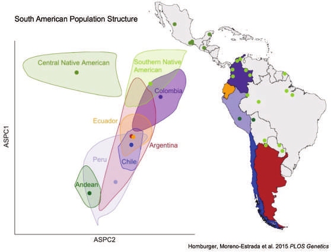

::: {.hero}
# A pangenome for Latin America

[We are sequencing 1,000 long-read genomes from Indigenous and admixed ancestries across Latin America to find the structural variation that reference misses, and to learn what it does in immune cells and in gallbladder cancer.]{.lede}
:::

```{ojs}
//| echo: false
cohorts = FileAttachment("data/cohorts.csv").csv({typed: true})
places = FileAttachment("data/countries.csv").csv({typed: true})
topojson = require("topojson-client@3")
world = d3.json("https://cdn.jsdelivr.net/npm/world-atlas@2/countries-110m.json")
land = topojson.feature(world, world.objects.countries)
partnerColor = new Map(places.map(d => [d.atlas_name, d.color]))
dark = document.body.classList.contains("quarto-dark")
```

```{ojs}
//| echo: false
totals = places.map(p => {
  const rows = cohorts.filter(d => d.country === p.country)
  return {...p, value: d3.sum(rows, d => d.lr_wgs ?? 0), n: rows.length}
}).filter(d => d.value > 0)

Plot.plot({
  width: Math.min(width, 760),
  height: Math.min(width, 760) * 1.05,
  projection: {
    type: "mercator",
    domain: {type: "MultiPoint", coordinates: [[-112, 30], [-36, -55]]},
    inset: 8
  },
  r: {range: [0, 34], domain: [0, 220]},
  marks: [
    Plot.geo(land, {fill: dark ? "#1E2D45" : "#E4E9EF", stroke: dark ? "#0E1A2E" : "#FFFFFF", strokeWidth: 0.6}),
    Plot.geo(land.features.filter(f => partnerColor.has(f.properties.name)), {
      fill: f => partnerColor.get(f.properties.name), fillOpacity: 0.4,
      stroke: dark ? "#0E1A2E" : "#FFFFFF", strokeWidth: 0.6
    }),
    Plot.dot(totals, {
      x: "lon", y: "lat", r: "value",
      fill: "color", stroke: dark ? "#E6ECF3" : "#14233C", strokeWidth: 1.2,
      title: d => `${d.country}\n${d.n} contributing cohort${d.n > 1 ? "s" : ""}`
    }),
    Plot.text(totals, {
      // label sits just right of each circle, so bigger circles push it further out
      x: d => d.lon + 0.8 + 3.6 * Math.sqrt(d.value / 220), y: "lat",
      text: "country", textAnchor: "start",
      fill: "currentColor", fontSize: 12, fontWeight: 600,
      stroke: dark ? "#0E1A2E" : "#F7F9FB", strokeWidth: 3, paintOrder: "stroke"
    })
  ]
})
```

Countries contributing long-read genomes to the LatinPangenome. Positions mark the country, not a specific community.

## From maps to medicine

```{=html}
<div class="m2m">
  <div class="stage">
    <div class="aim">Aim 1</div>
    <h3>Maps</h3>
    <p>Build a graph-based Latin American pangenome from 1,000 PacBio HiFi genomes at 30× and catalog the structural variants absent from the current reference.</p>
    <a class="more" href="research.qmd#maps">About the pangenome</a>
  </div>
  <div class="stage">
    <div class="aim">Aim 2</div>
    <h3>Mechanisms</h3>
    <p>Map how structural variants change gene expression in 29 cell types, using single-cell RNA from 520 of the same people.</p>
    <a class="more" href="research.qmd#mechanisms">About SV-eQTL mapping</a>
  </div>
  <div class="stage">
    <div class="aim">Aim 3</div>
    <h3>Medicine</h3>
    <p>Study germline and somatic structural variants in gallbladder cancer among Chilean patients of Mapuche ancestry, the population with the highest burden worldwide.</p>
    <a class="more" href="research.qmd#medicine">About the gallbladder study</a>
  </div>
</div>
<div class="foundation">
  <h3>Aim 4: Local capacity, local leadership</h3>
  <p>Sequencing, analysis and data stewardship happen in Latin America, with yearly hands-on workshops run with CABANAnet.</p>
</div>
```

## Why this matters

Populations of the Americas carry alleles found nowhere else, some with clear medical consequences. Yet the Human Pangenome Reference Consortium currently includes no reference population of Indigenous American ancestry, and Latin American populations are strongly substructured. Without a regional reference, the variation that drives health differences across the region stays invisible.

{fig-alt="PCA plot with ellipses for Central Native American, Southern Native American, Andean and admixed populations from Colombia, Ecuador, Peru, Chile and Argentina, next to a map of South America." width="85%"}

## Latest news

::: {#latest-news}
:::

[All news and updates](news/index.qmd)